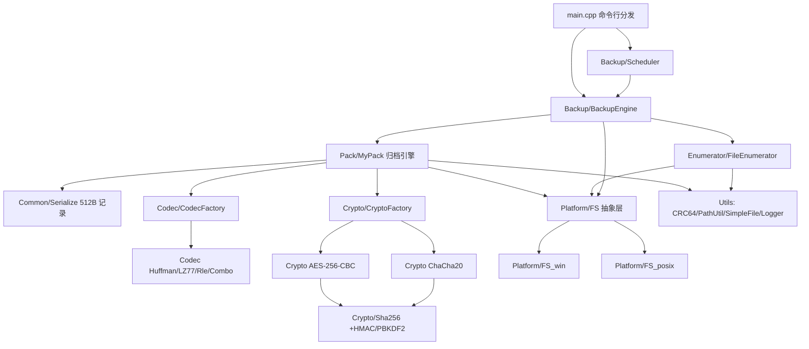
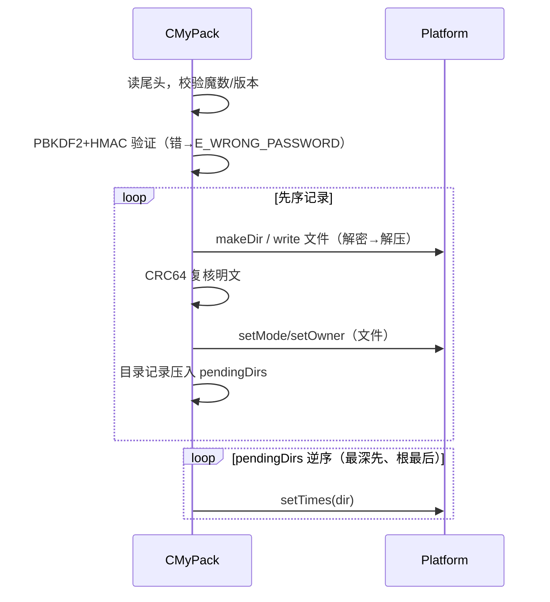
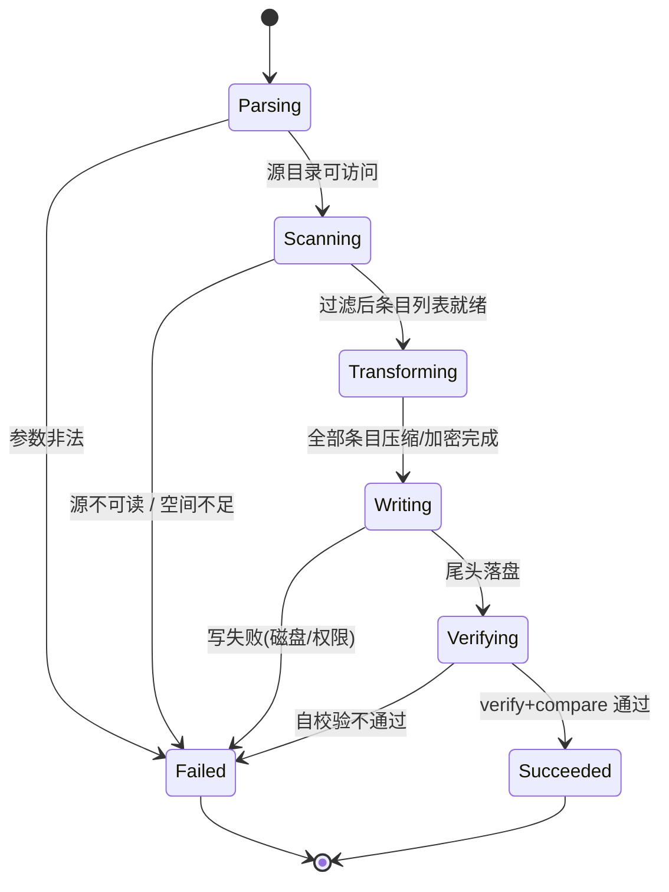

# 数据备份软件（dbkp / bk）系统设计说明书

> 对应实验报告模板"系统设计文档（20 分）"。图中 Mermaid 源码可直接粘到
> mermaid.live / VS Code 预览渲染，也可按图重绘为 Visio 版。

## 1. 开发环境和工具

### 1.1 开发环境
| 项 | 值 |
|---|---|
| 硬件平台 | x86-64 PC（Windows 11 实测机） |
| 操作系统 | Windows 11（本地自测）/ Ubuntu 22.04（提交平台，同一份代码） |
| 编译环境 | MinGW-w64 **g++ 8.1.0**（posix-seh），`-std=c++17 -Wall -Wextra -O2 -g -pthread` |
| 构建工具 | `Makefile`（自动探测平台选择 `FS_win.cpp` / `FS_posix.cpp`），Windows 侧用 `mingw32-make -j4` |
| IDE / 版本管理 | VS Code + Git |
| 测试 | 自带迷你 GoogleTest 框架（`test/TestFramework.h`，与 gtest 宏子集兼容）+ `script/e2e.ps1` |

### 1.2 依赖库
**零第三方库**。为满足"算法必须自己实现"的评分要求，以下全部手写并配官方测试向量：
Huffman（含定长回退）、LZ77（滑窗 + nibble 打包）、RLE（v2 令牌格式）、
AES-256（S-box/密钥扩展/CBC）、ChaCha20（20 轮 quarter round）、
SHA-256（K 表逐字核对）、HMAC-SHA256、PBKDF2（RFC 2898）、CRC64（ECMA-182 反射表）。
外部依赖只有 C++17 标准库 + Win32/POSIX 系统调用。

## 2. 总体设计

### 2.1 顶层系统结构
#### 2.1.1 构件图

#### 2.1.2 构件图描述
依赖方向**单向向下**，禁止回边：`Platform` 不知道归档的存在，`Codec/Crypto` 不知道文件
系统的存在（只处理 `std::vector<uint8_t>`），因此每个模块都能脱离磁盘单独单测——这正是
92 项单元测试能在毫秒级跑完大部分用例的原因。

| 子系统 | 职责 | 关键构件 |
|---|---|---|
| 命令接口 | 参数解析、退出码、人话摘要 | `main.cpp`（7 个子命令） |
| 备份执行 | 归档/复制两种模式分派、备份后校验、硬链接去重 | `CBackupEngine` |
| 调度 | 周期触发、时间戳命名、保留份数滚动删除 | `CScheduler` |
| 归档格式 | 记录序列化、数据块读写、尾头、篡改检测 | `CMyPack`、`CRecordReader` |
| 遍历与过滤 | 先序遍历 + 六维过滤 + 环检测 | `CFileEnumerator`、`FilterOptions` |
| 内容变换 | 压缩与加密的可插拔算法族 | `IDataCodec` 族 |
| 密码学 | SHA-256/HMAC/PBKDF2/AES/ChaCha20 | `CSha256`、`CAes256`、`CChaCha20` |
| 平台抽象 | 类型/元数据/长路径/特殊文件 | `Platform::` 命名空间 |

### 2.2 归档文件的物理布局（核心数据结构）
```
+---------------------------------------------------------------+
| 记录区  N × 512B（先序：目录在子项之前；超长路径插 X 扩展记录） |
+---------------------------------------------------------------+
| 数据区  Σ 每个 regular 文件 ceil(storedSize/512)*512 B         |
|         内容 = 压缩( 加密( 明文 ) )，硬链接后续项长度为 0        |
+---------------------------------------------------------------+
| 尾区    ArchiveHeader：版本/算法/载荷 SHA-256/HMAC/盐/迭代/    |
|         包装主密钥/记录区偏移/数据区偏移/条目统计/注释/魔数     |
+---------------------------------------------------------------+
```
记录字段偏移（`src/Common/Serialize.cpp:12`，小端）：

| 偏移 | 字段 | 宽度 | 偏移 | 字段 | 宽度 |
|---|---|---|---|---|---|
| 0 | recMagic | 4 | 62 | ino | 8 |
| 4 | type(`-DLBFCSHX`) | 1 | 70 | nlink | 4 |
| 5 | flags | 1 | 74 | dev | 4 |
| 6 | pathLen | 2 | 78 | major | 4 |
| 8 | linkLen | 2 | 82 | minor | 4 |
| 10 | mode | 4 | 86 | size | 8 |
| 14 | uid | 4 | 94 | storedSize | 8 |
| 18 | gid | 4 | 102 | crc64 | 8 |
| 22 | mtimeSec | 8 | 110 | compAlg | 1 |
| 30 | mtimeNSec | 4 | 111 | cryptoAlg | 1 |
| 38 | atimeSec | 8 | 114 | path（内联） | 160 |
| 46 | atimeNSec | 4 | 274 | link（内联） | 96 |
| 54 | ctimeSec | 8 | 370 | 预留 | 142 |

`flags`：`RF_HAS_EXTEND(0x01)` `RF_HARDLINK_SRC(0x02)` `RF_META_UID(0x04)`
`RF_META_MODE(0x08)` `RF_META_TIME(0x10)` `RF_CRC_VALID(0x20)` `RF_DIR_LAST(0x40)`。

## 3. 静态建模

### 3.1 系统类图（主要类）
```mermaid
classDiagram
  class CBackupEngine { +backup(BackupOptions) ErrCode
    +resolveMode(dst,mode) BackupMode
    +copyBackup/copyRestore/verifyCopy }
  class CScheduler { +run(ScheduleOptions) ErrCode
    +parseInterval(text) int64 }
  class CMyPack { +pack(src,dst,PackOptions) ErrCode
    +unpack(arc,dst,UnpackOptions) ErrCode
    +verify/list/stat/compare }
  class CFileEnumerator { +enumerateFiles(root,f,out) ErrCode
    +scanned()/filtered()/errors() }
  class FilterOptions { +pass(rel,FileInfo) bool
    +passForTraversal(rel,fi) bool +setTypeSpec(s) bool
    +describe() string }
  class IDataCodec { <<interface>> +encode(in,out) ErrCode
    +decode(in,out) ErrCode +name() string }
  class CryptoCodec { <<interface>> +encrypt/decrypt }
  class FileRecord { path link type flags mode uid gid
    mtime/atime/ctime(+nsec) ino nlink dev major minor
    size storedSize crc compAlg cryptoAlg }
  class Platform { <<namespace>> +getInfo/listDir/setTimes/setMode
    +makeSymlink/makeHardLink/makeFifo +openNative }
  CBackupEngine --> CMyPack : 归档模式
  CBackupEngine --> CFileEnumerator
  CBackupEngine --> Platform : 复制模式
  CScheduler --> CBackupEngine
  CMyPack --> IDataCodec : 经 CodecFactory
  CMyPack --> CryptoCodec : 经 CryptoFactory
  CMyPack --> FileRecord : Serialize
  CMyPack --> Platform
  CFileEnumerator --> FilterOptions
  CFileEnumerator --> Platform
### 3.2 类（对象）描述
| 类 | 用途 | 关键约束 |
|---|---|---|
| `CBackupEngine` | 备份的**唯一入口**，按目标形态分派归档/复制模式 | 无状态可重入；`resolveMode()` 为纯函数便于单测 |
| `CScheduler` | 定时与保留策略；进程内 sleep 循环 | 每轮独立调用 `CBackupEngine`；`--keep` 只删本轮之前生成的归档 |
| `CMyPack` | 归档读写、校验、列表、统计、比对 | 流式读写（1MB 缓冲），不把整文件读进内存 |
| `CFileEnumerator` | 先序遍历 + 过滤 + 符号链接环检测 | 不跟随链接（`getInfo(...,false)`）；`m_visitedDirs` 防环 |
| `FilterOptions` | 六维过滤的唯一裁决者 | 六维 AND；名称/尺寸/时间不剪断下降（见 6.2） |
| `IDataCodec` | 压缩算法抽象 | `encode/decode` 必须互逆；退化时允许"定长回退"但不得膨胀超一个块 |
| `CryptoCodec` | 加密算法抽象 | Encrypt-then-HMAC；口令错→`E_WRONG_PASSWORD` 而非乱码 |
| `CSha256` | 摘要 + `hmac()` + `pbkdf2()` + `deriveKey()` | 全部对 RFC 官方向量测试 |
| `Platform` | 跨平台文件操作 | 路径一律 UTF-8 进出；Windows 内部转 `\\?\` |
| `CRC64`/`CSimpleFile`/`Logger` | 工具 | Logger 为单例，`-v/-q` 全局调节 |

## 4. 动态建模

### 4.1 典型场景时序图
#### 4.1.1 场景一：`bk backup src arc.dbkp -a huffman -c aes256 -p P`
```mermaid
sequenceDiagram
  participant U as CLI
  participant E as CBackupEngine
  participant F as CFileEnumerator
  participant M as CMyPack
  participant C as CodecFactory
  participant K as CryptoFactory
  participant P as Platform
  U->>E: backup(BackupOptions)
  E->>E: resolveMode() => MODE_ARCHIVE
  E->>M: pack(src, arc, PackOptions)
  M->>F: enumerateFiles(src, filter)
  loop 每个条目
    F->>P: getInfo(child, follow=false)
    P-->>F: FileInfo(type/mode/uid/时间/ino/dev)
    F->>F: filter.pass() 六维 AND
  end
  F-->>M: 先序 EnumeratedEntry 列表
  loop 每个 regular 文件
    M->>P: openNative + 1MB 读
    M->>C: create(comp) -> CHuffman.encode
    M->>K: create(crypto) -> AES.encrypt(压缩流)
    M->>M: CRC64(明文) 写入记录
  end
  M->>M: 载荷 SHA-256 + HMAC + 包装主密钥
  M->>M: 写尾头 + 记录区 + 数据区
  M-->>E: ArchiveStat
  E->>M: verify(arc)   （--no-verify 可跳过）
  E-->>U: 条目数/压缩率/CRC，rc=0
```
流程说明（编号对应上图）：
1. 模式判定：目标以 `.dbkp` 结尾或 `--archive` → 归档；已存在目录或 `--copy` → 复制。
2. 遍历阶段只做"选择"，不读文件内容，保证可提前发现过滤错误。
3. 硬链接：`(dev,ino)` 首次出现者完整入档，后续记录 `type='H'`、长度 0，还原时建硬链。
4. 变换顺序固定为 **压缩 → 加密**（反过来加密流不可压）；每个文件独立成流，避免单点损坏扩散。
5. 口令参与两处：PBKDF2 派生主密钥包装（key wrap）与 HMAC 标签；两者任一失配都判定为口令错/损坏。

#### 4.1.2 场景二：`bk restore arc.dbkp dst`

要点：**目录元数据必须逆序回填**。若按先序处理，父目录的 mtime 会先被设好，随后创建其子项
又把父目录 mtime 顶成"现在"，导致还原后的目录时间与源不一致。

#### 4.1.3 场景三：`bk schedule src dstDir --every 1s --times 3 --keep 2`
`CScheduler` 生成 `bk-YYYYmmdd-HHMMSS.dbkp` 三次，每轮完成后按时间戳排序删除最老的，
最终保留 2 份；任何一轮失败都记录错误并继续下一轮（不因一次失败终止计划任务）。

### 4.2 系统状态：一次备份作业的状态机


## 5. 关键算法设计
| 算法 | 设计要点 | 复杂度 |
|---|---|---|
| Huffman | 频率建树 → 码长上限校验 → 超限退化为定长 8bit；码表随流头写出 | O(n + σ log σ) |
| LZ77 | 4KB 窗口 / 18bit 距离+7bit 长度打包成 nibble 流；字面量与匹配标记位交替 | O(n·w) 朴素匹配，实测 31 MB/s |
| RLE v2 | 令牌 `(run|literal, len)`，**保证随机数据不膨胀**（旧格式在无序数据上会放大 2 倍） | O(n) |
| AES-256-CBC | 手算 S-box/密钥扩展；CBC 每块随机 IV 前置；PKCS#7 填充 | 10 轮/块 |
| ChaCha20 | 20 轮 quarter-round，96bit nonce + 64bit counter，一次一密 | O(n) |
| SHA-256/HMAC/PBKDF2 | K 表逐字核对；HMAC ipad/opad；PBKDF2 支持跨块 dkLen | 4096 轮 ≈ 10 ms |
| CRC64 | ECMA-182 反射多项式，256 项表预计算 | O(n) |

## 6. 已知缺陷与对策（含讲义指出的问题）
| # | 问题 | 后果 | 本设计的对策 | 验证 |
|---|---|---|---|---|
| 1 | 相对路径含 `../` | 还原时写到目标外（路径遍历攻击） | 还原前 `Path::isPathTraversalSafe()` 拒绝 | PackErr 用例 |
| 2 | 超长路径 >398 被截断 | 还原后文件名错乱 | `X` 扩展记录分块承载；`\\?\` 突破 OS 限制 | Meta.VeryLongPath（444 字符） |
| 3 | 目录 mtime 被子项顶掉 | 还原后目录时间=备份时刻 | `pendingDirs` **逆序**回填 | Meta.ArchiveRestores + e2e metadata |
| 4 | 硬链接被复制成多份 | 空间翻倍、链接关系丢失 | `(dev,ino)` 去重 + `type='H'` 记录 | 单测 + `--no-hardlink` |
| 5 | 符号链接跟随 | 环、越界读取 | 默认 `follow=false` 存链接本身；可选跟随并做环检测 | 单测 |
| 6 | `--max-depth` 只拦下降不拦条目 | 深度 2 的文件混进"深度 1"备份 | 条目判定同样使用 depthOk，口径统一为 `find -maxdepth` | Filter.MaxDepth |
| 7 | RLE 在随机数据上膨胀 | 备份比原文件更大 | v2 令牌格式 + "不膨胀超一个块"断言 | Codec 单测 |
| 8 | Windows 260 字符限制 | 长路径静默漏备份 | `Path::apiWide()` 统一加 `\\?\`（含 UNC 分支） | e2e 7/7 文件回归 |
| 9 | 中文路径经 ANSI argv 乱码 | 找不到源目录 | `CommandLineToArgvW` + `SetConsoleOutputCP(CP_UTF8)` | 手工验证 |

## 7. 扩展预留与目录结构
- **增量/差异备份**：记录里已有 `crc64 + mtime + ino`，只需在 `CScheduler` 里保留上一份归档的
  索引，按 `(relPath, crc64)` 跳过未变更文件并写"引用记录"，即可实现；接口不破坏现有格式版本。
- **备份点数据库**：目前每个 `.dbkp` 自描述，可平铺到任意介质；若引入索引库只需新增构件，
  不改动 `CMyPack`。
```
dbkp/
  include/{Backup,Codec,Crypto,Common,Pack,Enumerator,Platform,Utils}/*.h
  src/     同名实现 + main.cpp
  test/    TestFramework.h + 14 个测试源文件（92 用例）
  script/  e2e.ps1 / _verify.ps1 / perf.ps1 / demo.sh
  doc/     本说明书 + 需求分析 + 测试报告 + perf-raw.txt
  Makefile 双平台构建
```

